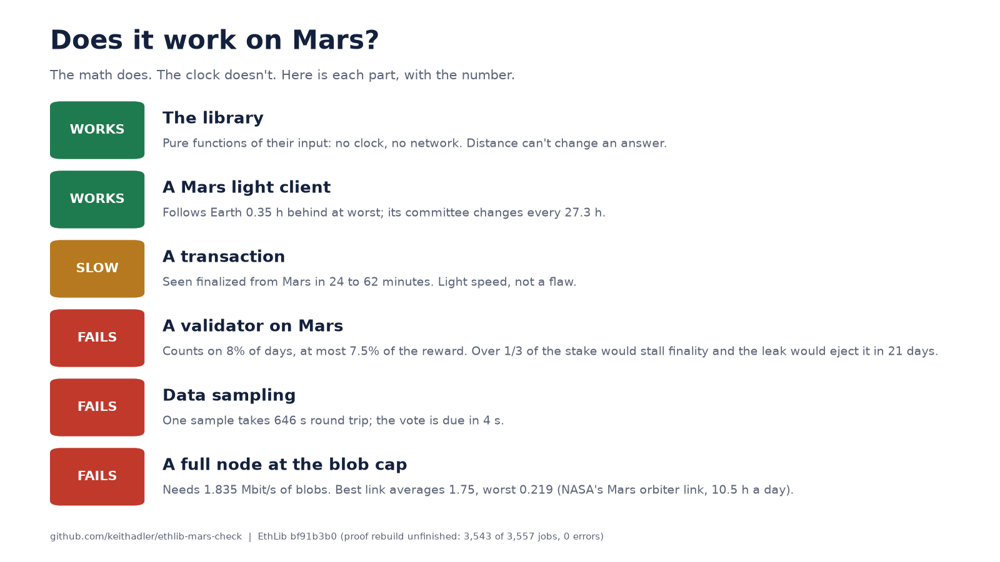
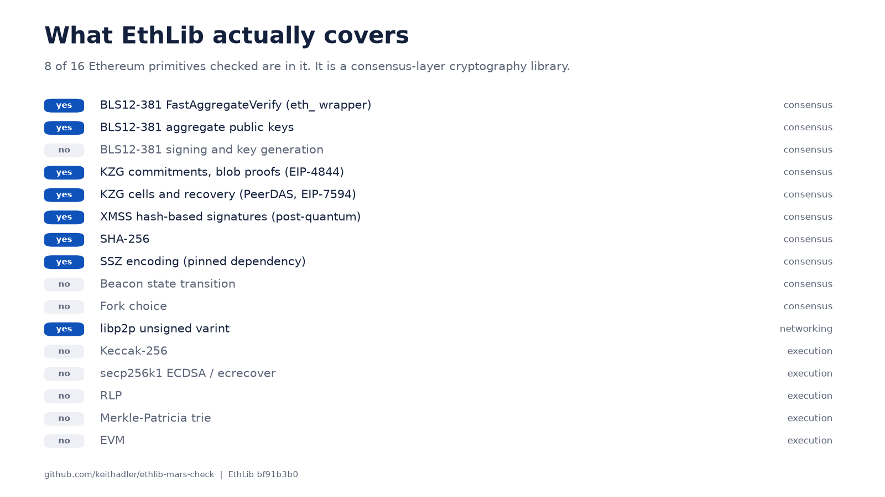
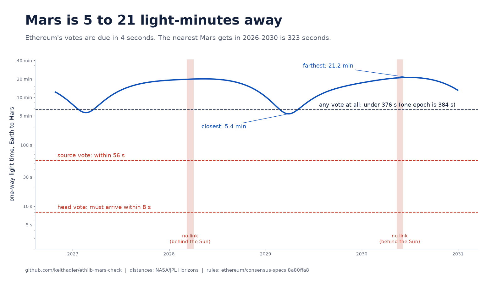
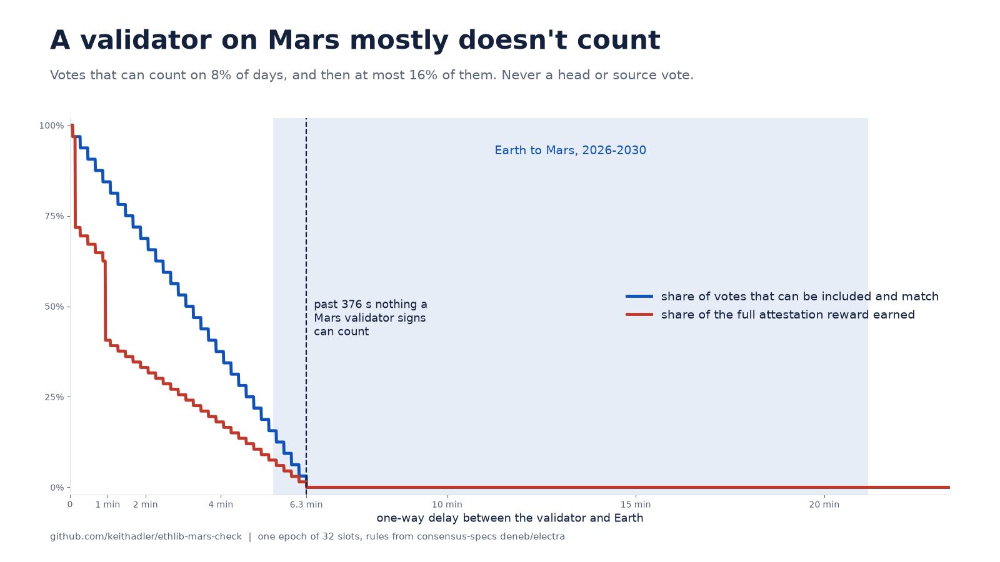

# ethlib-mars-check

Two questions about [ethereum/EthLib](https://github.com/ethereum/EthLib), the formally verified
Ethereum primitives written in Lean:

1. Does it cover Ethereum?
2. Would anything in it, or in the Ethereum protocol it serves, fail between Mars and Earth?



## Short answers

**It covers a slice.** I checked a 16-item list of Ethereum primitives (my own list, in `src/marscheck/audit.py`) against EthLib's source. 8 are in it:
BLS12-381 `FastAggregateVerify` and public-key aggregation, KZG blob proofs (EIP-4844), KZG cells and
recovery (PeerDAS, EIP-7594), XMSS, SHA-256, SSZ (a pinned dependency, not EthLib's own code) and the
libp2p varint. 8 are not: BLS signing, the beacon state transition, fork choice, Keccak-256, secp256k1,
RLP, the Merkle-Patricia trie and the EVM. EthLib says it is a library of primitives. That is accurate,
and it is the consensus-layer cryptography.

**The library does not care about Mars.** Its source reads no clock, no network, no randomness
(`results/coverage.json`, `time_and_io` is empty). Verifying a signature or a KZG proof gives the same
answer 20 light-minutes away.

**Ethereum's consensus timing does.** A validator on Mars cannot take part:

| what | result |
| --- | --- |
| One-way light time, 2026-2030 | 323 s (5.4 min) to 1,270 s (21.2 min) |
| Head vote must reach Earth within | 8 s |
| Source vote must reach Earth within | 56 s |
| Any vote can count only if one-way delay is under | 376 s |
| Days with any valid Mars vote | 119 of 1,527 (7.8%) |
| Best share of votes valid on those days | 15.6% |
| Best share of the full attestation reward | 7.5% |
| A head or source vote, ever | never |
| A Mars-submitted transaction, seen finalized from Mars | 24 to 62 minutes |
| One data-availability sample, round trip | 646 s at best (a vote is due in 4 s) |
| Days behind the Sun, no link | 50 |

What does work from Mars: a light client (it follows Earth at most 0.35 h behind, and its sync
committee changes every 27.3 h), and ordinary transactions, slowly. That is the speed of light, not a
design flaw.

## How the Mars part works

Nothing is typed in by hand.

* `tools/extract_spec.py` reads every number and rule out of a clone of
  [ethereum/consensus-specs](https://github.com/ethereum/consensus-specs) (commit
  `8a80ffa82bd49aac0dd6db17f9e8150aa257fbc2`) with its line number, and refuses to run if the code a
  rule is read from is not there. Output: `data/spec_constants.json`.
* `data/horizons_mars_*.txt` is the raw reply of NASA/JPL Horizons for Mars as seen from the center of
  the Earth, one row a day, 2026-10-27 to 2030-12-31. Light time is range times 499.004783836 s/AU.
* `src/marscheck/model.py` applies the specification's rules to a validator `D` seconds away:
  * an attestation can be included only while its target epoch is the current or previous one, so it
    dies at the end of the next epoch (`electra/beacon-chain.md`, `process_attestation`);
  * its source must equal the justified checkpoint, which moves every epoch, so a validator that sees
    the chain `D` seconds late has the new epoch's checkpoints only `D` seconds into the epoch;
  * the source flag needs inclusion within `isqrt(32)` = 5 slots, the head flag within 1 slot
    (`deneb/beacon-chain.md`).
* `tools/run_model.py` runs it over all 1,527 days. `tools/make_images.py` draws the images from the
  results.

The model reads the rules generously (Earth's epoch-start block is assumed available the instant the
epoch begins; a block proposer takes a vote right up to the start of its slot), so a "no" is firm.

## What this does not show

* **No executable-spec run.** The model is a reading of the specification text and constants. I did
  not run it against the consensus-specs executable Python spec, so a subtle rule I misread would not
  be caught by that. The numbers cite exact spec lines so it can be checked by eye.
* **It assumes the chain finalizes every epoch**, which is the normal state. During a stall, the
  source-freshness rule loosens.
* **The leak figure applies only if Mars held more than a third of the stake.** Then the chain stops
  finalizing and the inactivity leak ejects the silent stake in 4,822 epochs (21.4 days). With less,
  Mars validators are simply penalized for missed votes and stay in.
* **Bandwidth uses one orbiter's published link**: 0.5 to 4 Mbit/s, data sent 10 to 11 hours of every
  24 ([NASA/JPL MRO communications](https://webarchive.library.unt.edu/web/20130308105753/http://mars.jpl.nasa.gov/mro/mission/communications)).
  A dedicated Earth-Mars network would change that. The 1.835 Mbit/s figure is the blob cap (21 blobs
  a block); real blocks carry fewer.
* **The 3 degree blackout cut is my assumption**, not a Horizons output.
* **Only Ethereum's consensus timing is modeled.** Not rollups, not a purpose-built interplanetary
  design, which would not look like this at all.

## The EthLib audit

`src/marscheck/audit.py` reads a checkout of EthLib and decides each row from a file or an exported
C symbol, never from a claim. At commit `bf91b3b058ed8553e3e030ba8254a6eeb517221b`: 36 exported
entry points, 8 of 16 checklist primitives, `sorry` and `axiom` absent, and two `native_decide` known
answers in the XMSS proofs, both already in EthLib's own `scripts/check_decls_baseline.txt`.
I also tried to rebuild its proofs with `lake build`. **That did not finish.** 3,543 of 3,557 jobs
completed with no error, covering the library and 42 of the BLS, KZG and XMSS proof modules, then
`Proofs/Hash/Blake2s.lean` stalled on a machine with 12 GB of memory in heavy swap, and I could not get
it through. So `lake exe check-decls` and EthLib's own Python vector tests were not run here. Treat the
verification as unfinished, not as passed (`results/ethlib_verification.json`).



## Run it

```sh
python3 -m venv .venv && .venv/bin/pip install matplotlib numpy pytest
git clone https://github.com/ethereum/consensus-specs      # then check out the pinned commit
git clone https://github.com/ethereum/EthLib
.venv/bin/python tools/extract_spec.py consensus-specs > data/spec_constants.json
PYTHONPATH=src .venv/bin/python -m marscheck.audit EthLib > results/coverage.json
.venv/bin/python tools/run_model.py
.venv/bin/python tools/make_images.py
.venv/bin/python -m pytest
```




## License

MIT. EthLib is CC0. The consensus specifications are CC0. Horizons data is from NASA/JPL.
